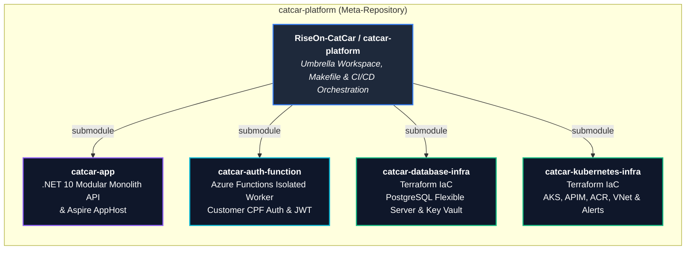
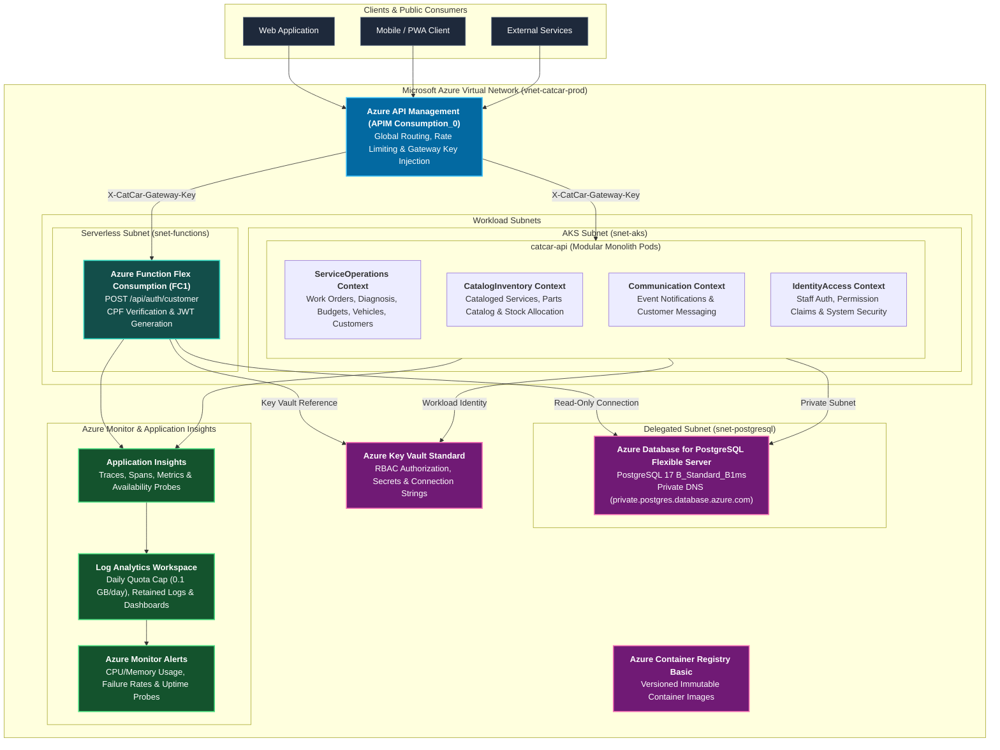

# CatCar Platform

[](https://github.com/RiseOn-CatCar)
[](https://dotnet.microsoft.com/)
[](https://learn.microsoft.com/dotnet/csharp/)
[](https://learn.microsoft.com/dotnet/aspire/)
[](https://www.terraform.io/)
[](https://azure.microsoft.com/)
[](https://kubernetes.io/)

> **The umbrella meta-repository and engineering workspace for the CatCar car repair shop management platform under the [`RiseOn-CatCar`](https://github.com/RiseOn-CatCar) organization.**

`catcar-platform` coordinates the distributed components, backend applications, serverless functions, and infrastructure stacks that power CatCar. By pinning each independent component as a Git submodule, this repository guarantees reproducible, known-compatible platform builds across local development, testing, and production cloud environments under an **academic cloud consolidation model**.

---

## Table of Contents

- [Repository Topology](#repository-topology)
- [System Architecture & Cloud Topology](#system-architecture--cloud-topology)
- [Local Development Runtime with .NET Aspire](#local-development-runtime-with-net-aspire)
- [Quick Start Guide](#quick-start-guide)
- [Makefile Developer Commands](#makefile-developer-commands)
- [Automation Scripts & Control Plane](#automation-scripts--control-plane)
- [Project Documentation & Architecture Records](#project-documentation--architecture-records)
- [Submodule Workflow & Contribution Guide](#submodule-workflow--contribution-guide)
- [Platform Technology Stack & Cost Model](#platform-technology-stack--cost-model)

---

## Repository Topology

The CatCar platform decouples application domains, serverless identity services, and cloud infrastructure into specialized, independently versioned repositories under the [`RiseOn-CatCar`](https://github.com/RiseOn-CatCar) GitHub organization:



### Component Breakdown

```
+-------------------------------------------------------------------------------------------------------------------+
|                                          RiseOn-CatCar / catcar-platform                                          |
|                                            (Umbrella Meta-Repository)                                             |
+---------------------------+-----------------------------------+---------------------------------------------------+
| Component Submodule       | Role & Architectural Scope        | Remote Repository Link                            |
+---------------------------+-----------------------------------+---------------------------------------------------+
| catcar-app                | Backend Modular Monolith API,     | https://github.com/RiseOn-CatCar/catcar-app       |
|                           | Domain Contexts, EF Core, Wolverine|                                                   |
|                           | Outbox, and .NET Aspire AppHost   |                                                   |
| catcar-auth-function      | Serverless Azure Function (.NET   | https://github.com/RiseOn-CatCar/catcar-auth-function|
|                           | 10 Isolated) for customer CPF     |                                                   |
|                           | validation & JWT token issuance   |                                                   |
| catcar-database-infra     | Terraform IaC provisioning Azure  | https://github.com/RiseOn-CatCar/catcar-database-infra|
|                           | Database for PostgreSQL Flexible  |                                                   |
|                           | Server, Key Vault & Private DNS   |                                                   |
| catcar-kubernetes-infra   | Terraform IaC provisioning Azure  | https://github.com/RiseOn-CatCar/catcar-kubernetes-infra|
|                           | Virtual Network, AKS Cluster,     |                                                   |
|                           | API Management (APIM), ACR & OTel |                                                   |
+---------------------------+-----------------------------------+---------------------------------------------------+
```

---

## System Architecture & Cloud Topology

Under the **academic cloud consolidation model**:
- **Production Environment (`catcar-prod`)**: Single live Azure cloud environment hosting APIM (Consumption), AKS (Free, 1-2 `Standard_B2s` nodes), Auth Function (Flex Consumption FC1), PostgreSQL 17 (Flexible Server B1ms), ACR (Basic), and Key Vault (Standard).
- **Pre-Production / Homologation**: Local developer workspace running the complete topology via .NET Aspire AppHost (`make dev`).
- **Trunk-Based Delivery**: `main` is the single protected branch. CI runs on PRs and pushes to `main`. Production deployments run on stable SemVer release tags (`v*.*.*`) whose commits are reachable from `main`.
- **Ingress & Origin Hardening**: APIM injects `X-CatCar-Gateway-Key` on all backend requests. Production origins reject POST requests missing or carrying an invalid key with HTTP 403 Forbidden. Health probes (`/health/live`, `/health/ready`) are exempt.
- **Cold-by-Default Operations**: Compute workloads (AKS and PostgreSQL) are automatically stopped nightly at 02:00 UTC via `.github/workflows/cloud-runtime.yml` to preserve the USD 100 student credit, and started on demand via `workflow_dispatch` or deployment pipelines.



---

## Local Development Runtime with .NET Aspire

Developers do not need an active Azure subscription to run and test CatCar. The `.NET Aspire AppHost` (`src/Host/CatCar.AppHost`) provisions and wires all dependencies locally in containerized form.

```bash
# Clone the platform repository with submodules
git clone --recurse-submodules https://github.com/RiseOn-CatCar/catcar-platform.git
cd catcar-platform

# Start local dev environment (PostgreSQL 17, Azurite emulator, API, Auth Function & Aspire Dashboard)
make dev
```

---

## Quick Start Guide

### Prerequisites
- **.NET 10 SDK** (`net10.0`)
- **Docker Desktop / Podman**
- **HashiCorp Terraform** (`>= 1.5.0`)
- **Azure CLI (`az`)** & **GitHub CLI (`gh`)**

### Common Workflows
```bash
# Display help and all available Makefile targets
make help

# Build all .NET solutions across the umbrella workspace
make build

# Run all test suites across all repositories (unit, architecture, integration, E2E)
make test

# Format C# code and Terraform configurations
make format

# Validate Terraform IaC across all infrastructure submodules
make infra-validate

# Sync Git submodules
make git-sync
```

---

## Automation Scripts & Control Plane

- **`scripts/bootstrap-azure.sh`**: Idempotent control-plane setup script configuring Microsoft Entra ID workload identities (OIDC), state storage (`catcar-tfstate`), GitHub environment variables, and branch protection rules for `main`.
- **`.github/workflows/cloud-runtime.yml`**: Centralized control workflow supporting manual (`workflow_dispatch`) `start`, `stop`, and `status` operations and a scheduled nightly stop at 02:00 UTC.
- **`scripts/kind-with-registry.sh`**: Local Kind Kubernetes cluster provisioner with embedded registry on `localhost:5001`.

---

## Project Documentation & Architecture Records

All architectural decisions, Domain-Driven Design artifacts, RFC proposals, security audit reports, and delivery guides are maintained in the [`docs/`](docs/) directory:

- [Fase 3 Student Portal Delivery Document](docs/delivery/TECH_CHALLENGE_FASE_3_ENTREGA.md) and [HTML version](docs/delivery/TECH_CHALLENGE_FASE_3_ENTREGA.html)
- [CatCar Platform Postman Collection v2.1.0](docs/postman/CatCar_Platform.postman_collection.json) and [environment template](docs/postman/CatCar_Platform.postman_environment.json)
- [Azure Control-Plane Bootstrap Runbook](docs/azure-bootstrap.md)
- [Vulnerability Audit & Security Governance Report](docs/vulnerability-report.md)
- [Architecture Decision Records (ADRs)](docs/architecture/adr/)
  - [ADR 001: Transactional Outbox Pattern](docs/architecture/adr/001-transactional-outbox.md)
  - [ADR 002: HPA and APIM Gateway](docs/architecture/adr/002-hpa-and-apim-gateway.md)
  - [ADR 003: Multi-Repository Topology & Consolidation](docs/architecture/adr/003-repository-topology.md)
- [Domain-Driven Design (DDD) Specifications](docs/ddd/)

---

## Platform Technology Stack & Cost Model

| Domain | Technology / Tool | Version | SKU / Cost Tier |
|---|---|---|---|
| **Language & Runtime** | C# 14 / .NET 10 LTS | `net10.0` | Open Source |
| **Serverless Auth** | Azure Functions (.NET 10 Isolated) | v4 | Flex Consumption (`FC1`, scale-to-zero) |
| **API Gateway** | Azure API Management | Consumption | `Consumption_0` (first 1M calls/month free) |
| **Container Compute** | Azure Kubernetes Service (AKS) | Kubernetes 1.30+ | `Free` tier (1-2 `Standard_B2s` nodes) |
| **Container Storage** | Azure Container Registry (ACR) | Docker v2 | `Basic` SKU |
| **Database** | PostgreSQL Flexible Server | v17 | `B_Standard_B1ms` (32 GiB storage) |
| **Secrets & Keys** | Azure Key Vault | Standard | `Standard` SKU |
| **Observability** | Azure Monitor & Application Insights | PerGB2018 | 30 days retention (0.1 GB/day limit) |
| **Cost Management** | Azure Consumption Budget | Subscription | Total USD 100 student credit budget |

---

This project is maintained by the **RiseOn-CatCar** engineering team. All source code repositories under the umbrella are governed by their respective licenses. For questions, architectural review, or support, visit the [`RiseOn-CatCar`](https://github.com/RiseOn-CatCar) organization.
