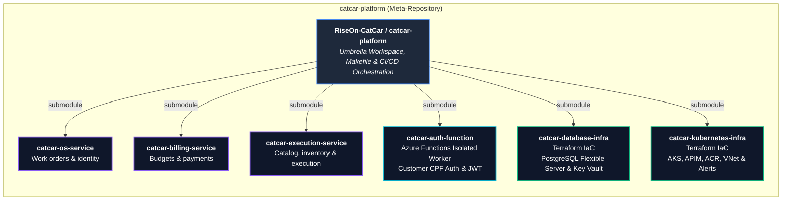
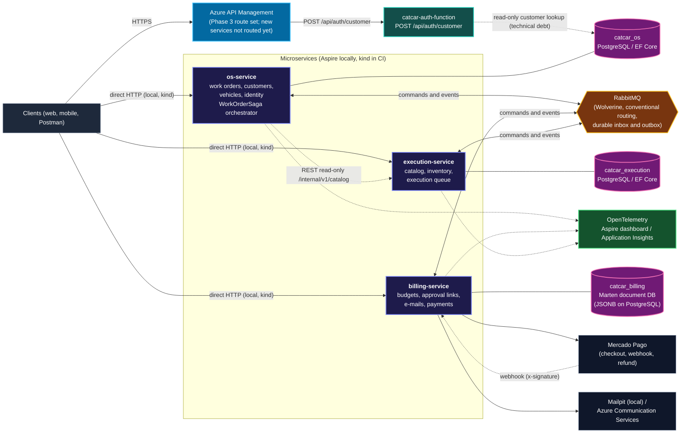
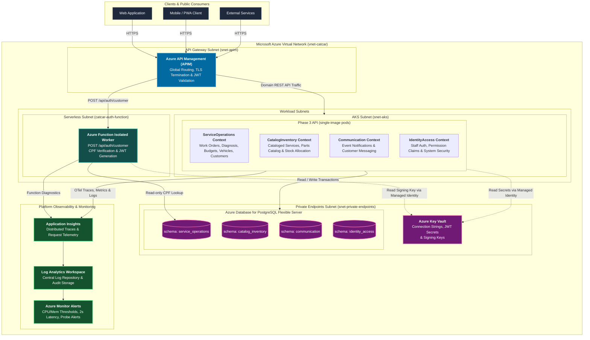

# CatCar Platform

[](https://github.com/RiseOn-CatCar)
[](https://dotnet.microsoft.com/)
[](https://learn.microsoft.com/dotnet/csharp/)
[](https://learn.microsoft.com/dotnet/aspire/)
[](https://www.terraform.io/)
[](https://azure.microsoft.com/)
[](https://kubernetes.io/)

> **The umbrella meta-repository and engineering workspace for the CatCar car repair shop management platform under the [`RiseOn-CatCar`](https://github.com/RiseOn-CatCar) organization.**

`catcar-platform` coordinates the distributed components, backend applications, serverless functions, and infrastructure stacks that power CatCar. By pinning each independent component as a Git submodule, this repository guarantees reproducible, known-compatible platform builds across local development, testing, and production cloud environments.

---

## Table of Contents

- [Repository Topology](#repository-topology)
- [System Architecture & Cloud Topology](#system-architecture--cloud-topology)
- [Local Development Runtime with .NET Aspire](#local-development-runtime-with-net-aspire)
- [Quick Start Guide](#quick-start-guide)
- [Makefile Developer Commands](#makefile-developer-commands)
- [Automation Scripts](#automation-scripts)
- [Project Documentation & Architecture Records](#project-documentation--architecture-records)
- [Submodule Workflow & Contribution Guide](#submodule-workflow--contribution-guide)
- [Platform Technology Stack](#platform-technology-stack)
---

## Repository Topology

The CatCar platform decouples application domains, serverless identity services, and cloud infrastructure into specialized, independently versioned repositories under the [`RiseOn-CatCar`](https://github.com/RiseOn-CatCar) GitHub organization:



### Component Breakdown

| Component | Role | Database | Documentation |
| :--- | :--- | :--- | :--- |
| `catcar-os-service` | Work orders, customers, vehicles and administrative identity; hosts the `WorkOrderSaga` orchestrator | PostgreSQL `catcar_os` (EF Core) | [Repository](https://github.com/RiseOn-CatCar/catcar-os-service) |
| `catcar-billing-service` | Budgets, approval links, e-mails and Mercado Pago payments | Marten document database (JSONB on PostgreSQL) `catcar_billing` | [Repository](https://github.com/RiseOn-CatCar/catcar-billing-service) |
| `catcar-execution-service` | Service catalog, inventory, reservations and execution queue | PostgreSQL `catcar_execution` (EF Core) | [Repository](https://github.com/RiseOn-CatCar/catcar-execution-service) |
| `catcar-auth-function` | Customer authentication by CPF and JWT issuance (Azure Function) | Read-only access to the customers table of `catcar_os` (recorded technical debt) | [Repository](https://github.com/RiseOn-CatCar/catcar-auth-function) |
| `catcar-database-infra` | PostgreSQL and secrets infrastructure | n/a | [Repository](https://github.com/RiseOn-CatCar/catcar-database-infra) |
| `catcar-kubernetes-infra` | AKS, APIM, ACR and observability infrastructure | n/a | [Repository](https://github.com/RiseOn-CatCar/catcar-kubernetes-infra) |

Each microservice has its own repository, database, Dockerfile, Kubernetes manifests (`k8s/base` and `k8s/overlays/ci`) and independent CI pipeline (build, tests with an 80% coverage gate, SonarCloud, security scans and an ephemeral kind deployment). The `main` branch of every component requires a pull request and the checks `build-test`, `security`, `sonar` and `deploy-kind`.

---

## System Architecture & Cloud Topology

### Phase 4: Microservices Architecture

The OS, Billing and Execution services are independent deployables. No service reads another service's database. Asynchronous messaging over RabbitMQ (Wolverine, durable inbox and outbox) carries commands and events; the only synchronous call is a read-only catalog lookup from the OS service to the Execution service. The OS service runs the orchestrated `WorkOrderSaga` with compensations (see [`docs/architecture/messaging-contracts.md`](docs/architecture/messaging-contracts.md)).



Saga flow: `RequestBudget` -> `BudgetIssued` -> customer approval -> `BudgetApproved` -> `ReserveParts` -> `PartsReserved` -> `RequestPayment` -> `PaymentConfirmed` -> `StartExecution` -> `ExecutionCompleted`. Failures trigger compensations (`CancelBudget`, `ReleaseParts`, `RefundPayment`).

### Architectural Highlights

- **Service ownership**: OS owns work orders and identity; Billing owns budgets, communications and payments; Execution owns catalog, inventory and repair execution.
- **Data**: one database per service; OS and Execution use PostgreSQL with EF Core, Billing uses Marten as a document database (JSONB on PostgreSQL), which keeps the Wolverine inbox, outbox and transactions in the same store.
- **Integration**: asynchronous messaging through RabbitMQ with stable `[MessageIdentity]` contracts duplicated per service (no shared contracts library); synchronous REST only for the read-only catalog lookup.
- **Consistency**: the OS service orchestrates the `WorkOrderSaga` (approval and payment timeouts, compensations that release parts, cancel budgets and refund payments).
- **Release boundary**: The existing AKS pipeline is still the Phase 3 single-image path, not a deployment of the microservices topology.
- **Observability**: OpenTelemetry through each service's `ServiceDefaults`; traces propagate across RabbitMQ through Wolverine. Aspire dashboard locally, Application Insights as the Phase 3 cloud target.

### Phase 3 Cloud Topology

**Azure release scope:** the existing AKS release remains the Phase 3 single-image deployment; deploying the Phase 4 microservices to AKS is outside the scope of Phase 4. The diagram below describes the existing Phase 3 cloud topology, not a deployed Phase 4 architecture. Kind is used for local validation and for the ephemeral deployment in each service CI; only strict version tags initiate Azure deployment.



---

## Local Development Runtime with .NET Aspire

Local platform execution is orchestrated through `aspire/CatCar.AppHost/CatCar.AppHost.csproj`. `make dev` starts the OS, Billing and Execution services, the authentication function, PostgreSQL (databases `catcar_os`, `catcar_billing` and `catcar_execution`), RabbitMQ, Mailpit and the Aspire dashboard. Mercado Pago credentials are optional parameters (`mercadopago-access-token`, `mercadopago-webhook-secret`, `mercadopago-notification-url`); without them the payment step fails fast and the saga compensates.

The dashboard displays service endpoints, health, logs and traces. Each service owns its data; RabbitMQ carries asynchronous integration messages. The services do not reference each other at build time; the AppHost references the three APIs by submodule path.

---

## Quick Start Guide

### Prerequisites

Ensure the following tools are installed on your workstation:

- [.NET 11 SDK](https://dotnet.microsoft.com/download/dotnet/11.0) (version pinned in `global.json`)
- [Docker](https://www.docker.com/) or [Podman](https://podman.io/) (for local database and storage containers)
- [Terraform](https://www.terraform.io/) (`>= 1.5.0`)
- [GNU Make](https://www.gnu.org/software/make/) (`>= 4.0`)
- [Azure Functions Core Tools](https://learn.microsoft.com/azure/azure-functions/functions-run-local) (`v4.14.0+`, required for isolated function execution)

### 1. Clone the Platform

Clone the platform repository with the `--recurse-submodules` flag to automatically fetch all pinned submodule revisions:

```bash
git clone --recurse-submodules https://github.com/RiseOn-CatCar/catcar-platform.git
cd catcar-platform
```

If you already cloned without submodules, initialize and populate them with:

```bash
git submodule update --init --recursive
```

### 2. Multi-Repository Workspace Configuration

Open the unified workspace in your preferred IDE:

```bash
# Visual Studio Code
code catcar.code-workspace

# Cursor
cursor catcar.code-workspace

# Windsurf
windsurf catcar.code-workspace
```

For **JetBrains Rider**, open the root `catcar-platform` directory and attach the service and authentication solutions.

`catcar.code-workspace` automatically configures:
- Multi-root project navigation for the six component repositories.
- Default .NET solution set to `catcar-os-service/CatCar.slnx`.
- Automatic C# format-on-save rules.
- Terraform Language Server integration and formatting settings.

### 3. Build & Run Locally

```bash
# 1. Restore all dependencies across application and function solutions
make restore

# 2. Launch the local microservices topology and Aspire Dashboard
make dev
```

Once started, the terminal displays the Aspire Dashboard URL (typically `http://localhost:18888` or a dynamic port). Open it in your browser to inspect live resource health, logs, and distributed traces.

---

## Makefile Developer Commands

The platform includes a standardized GNU `Makefile` configured with strict shell safety flags (`bash -eu -o pipefail -c`). All tasks can be discovered with `make` or `make help`.

| Target | Description | Executed Actions |
| :--- | :--- | :--- |
| `make help` | Displays the command menu and target descriptions | Formatted catalog output (default goal) |
| `make restore` | Restores .NET dependencies | Runs restore for the configured solutions |
| `make build` | Compiles configured solutions | Runs `dotnet build` |
| `make test` | Runs configured test suites | Runs `dotnet test` |
| `make dev` | Launches the local platform via the platform Aspire AppHost | Starts the service topology |
| `make kind-up` | Starts or reuses the local Kind cluster and registry | `scripts/kind-with-registry.sh` |
| `make kind-validate` | Validates the pinned platform locally | `scripts/validate-kind.sh` |
| `make format` | Formats C# code and Terraform configurations | `dotnet format` and `terraform fmt -recursive` |
| `make infra-validate` | Validates database, Kubernetes, and alert Terraform stacks | `terraform init -backend=false` and `terraform validate` across infra modules |
| `make git-status` | Displays short branch status and submodule commit SHAs | `git status --short --branch` and `git submodule status` |
| `make git-sync` | Rebase-pulls platform and syncs submodules to remote heads | `git pull --rebase` and `git submodule update --remote --merge` |

---

## Automation Scripts

The platform provides standardized shell scripts located in [`scripts/`](scripts/) for local environment setup and cloud control-plane initialization:

| Script Path | Purpose | Description |
| :--- | :--- | :--- |
| [`scripts/kind-with-registry.sh`](scripts/kind-with-registry.sh) | Local Kubernetes Cluster | Creates a local multi-node [Kind](https://kind.sigs.k8s.io/) cluster with an integrated Docker container registry on `localhost:5001`. |
| [`scripts/bootstrap-azure.sh`](scripts/bootstrap-azure.sh) | Azure & GitHub Bootstrap | Establishes the Azure foundation (Resource Groups, Storage Account, Microsoft Entra OIDC Apps, RBAC) and GitHub Actions environments/secrets without provisioning application workloads. |
| [`scripts/validate-kind.sh`](scripts/validate-kind.sh) | Local Kubernetes validation | Builds and exercises the pinned application images in Kind and records local-only evidence. |
| [`scripts/deploy-azure.sh`](scripts/deploy-azure.sh) | Coordinated Azure release | Executes gated release phases against the single Azure environment. |

See the [Azure Bootstrap Guide](docs/azure-bootstrap.md) and [Release Process](docs/release-process.md) for prerequisites, governance, and recovery.

Platform CI requires `Component Checks`, `Pinned Integration`, and `Release Images`, including E2E and Trivy. Component PR-head mode supports review of coordinated changes only; merge component PRs and repin their successfully checked `main` commits before tagging. Kind is not a CI or release gate.

---

## Project Documentation & Architecture Records

All architectural decisions, Domain-Driven Design artifacts, RFC proposals, security audits, and phase requirements are documented in [`docs/`](docs/):

### Architecture Decision Records (ADRs)
- [ADR 001: Asynchronous Cross-Context Communication with a Transactional Outbox](docs/architecture/adr/001-asynchronous-communication-outbox.md)
- [ADR 002: HPA Workload Scaling and APIM Rate Limiting](docs/architecture/adr/002-hpa-and-apim-scaling.md)
- [ADR 003: Multi-Repository Topology and Aspire Submodule Composition](docs/architecture/adr/003-repository-topology.md)

### Requests for Comments (RFCs)
- [RFC 001: Cloud Provider Selection (Microsoft Azure)](docs/architecture/rfc/001-cloud-provider-selection.md)
- [RFC 002: Managed Database Engine Selection (PostgreSQL 17)](docs/architecture/rfc/002-managed-database.md)
- [RFC 003: Serverless Customer Authentication with Azure Functions](docs/architecture/rfc/003-serverless-auth.md)

### Domain-Driven Design (DDD) Artifacts
- [DDD Overview & Strategic Design](docs/ddd/README.md)
- [Strategic Context Map](docs/ddd/context-map.md)
- [Module Structure & Solution Organization](docs/ddd/module-structure.md)
- [Event Storming Domain Flows](docs/ddd/event-storming.md)
- [Ubiquitous Language Glossary](docs/ddd/glossary.md)

### Operations, Security & Requirements
- [Azure Control-Plane Bootstrap Runbook](docs/azure-bootstrap.md)
- [Phase 1/2 Vulnerability & Security Report](docs/vulnerability-report.md)
- [Cloud Components & Topology Specification](docs/architecture/cloud-components.md)
- [Authentication & Work Order Sequence Diagrams](docs/architecture/auth-sequence.md)
- [Entity-Relationship (ER) Model](docs/architecture/er-model.md)
- [Phase 4 microservice contracts, Saga and layout](docs/architecture/messaging-contracts.md)
- [Phase 4 implementation plan](docs/fase-4-implementation-plan.md)
- [Tech Challenge Phase Requirements (Fase 1-4)](docs/requirements/)
- [Fase 3 Student Portal Delivery Document](docs/delivery/TECH_CHALLENGE_FASE_3_ENTREGA.md) and [print-ready HTML equivalent](docs/delivery/TECH_CHALLENGE_FASE_3_ENTREGA.html)
- [Fase 4 Student Portal Delivery Document](docs/delivery/TECH_CHALLENGE_FASE_4_ENTREGA.md) and [print-ready HTML equivalent](docs/delivery/TECH_CHALLENGE_FASE_4_ENTREGA.html)
- [CatCar Platform Postman Collection v2.1.0](docs/postman/CatCar_Platform.postman_collection.json) and [environment template](docs/postman/CatCar_Platform.postman_environment.json) (OS, Billing and Execution services)
---

## Submodule Workflow & Contribution Guide

`catcar-platform` uses Git submodules to maintain strict version pinning across repositories. Each submodule references a specific commit hash (gitlink) in its target repository. Follow these workflows when contributing.

### Workflow A: Developing Changes in a Sub-Repository

Always perform code changes, commit, and push directly within the specific submodule directory:

```bash
# 1. Navigate to the submodule
cd catcar-os-service

# 2. Create and switch to your feature branch
git checkout -b feature/work-order-lifecycle

# 3. Implement changes, test locally
dotnet test

# 4. Commit and push to the component repository
git commit -am "feat(service-ops): add work order lifecycle events"
git push -u origin feature/work-order-lifecycle

# 5. Open and merge a Pull Request in RiseOn-CatCar/catcar-os-service
```

### Workflow B: Updating the Submodule Pointer in the Platform

Once the changes are merged upstream in the submodule repository, update the platform pointer so team members and CI pipelines pick up the latest revision:

```bash
# 1. From the platform root, navigate to the submodule and pull latest main
cd catcar-os-service
git checkout main
git pull origin main

# 2. Return to the platform root
cd ..

# 3. Check status (git detects the updated submodule commit SHA)
git status
# modified:   catcar-os-service (new commits)

# 4. Stage, commit, and push the updated gitlink
git add catcar-os-service
git commit -m "chore: bump catcar-os-service submodule pointer to latest main"
git push origin main
```

### Workflow C: Synchronizing All Submodules to Latest Remote Heads

To advance all submodules to their latest tracked remote branches in one step:

```bash
make git-sync
```

Or manually:

```bash
git pull --rebase
git submodule update --init --recursive
git submodule update --remote --merge
git commit -am "chore: update platform component pointers"
git push origin main
```

---

## Platform Technology Stack

| Layer | Technologies & Tools |
| :--- | :--- |
| **Language & Frameworks** | C# on .NET 11 (SDK `11.0.100`), ASP.NET Core, Azure Functions (.NET Isolated Worker v4) |
| **Architectural Patterns** | Domain-Driven Design (DDD), Microservices, Vertical Slice Architecture, orchestrated Saga and Transactional Outbox |
| **Data & Persistence** | PostgreSQL with EF Core and UUID v7 (OS, Execution); Marten document database on PostgreSQL JSONB (Billing) |
| **Messaging & Events** | Wolverine 6, RabbitMQ, durable inbox and outbox |
| **Local Orchestration** | .NET Aspire AppHost, Docker / Podman, RabbitMQ and Mailpit |
| **Infrastructure as Code** | Terraform (`~> 1.5.0`), HashiCorp AzureRM Provider (`~> 4.0`) |
| **Container & Cloud** | Azure Kubernetes Service (AKS), Azure Container Registry (ACR), Azure API Management (APIM) |
| **Security & Secrets** | Azure Key Vault, Azure Private Endpoints, Managed Identity, JWT (HMAC-SHA256) |
| **Observability & Health** | OpenTelemetry (OTel), Application Insights, Azure Monitor, Log Analytics, Aspire Dashboard |

---

## License & Organization

This project is maintained by the **RiseOn-CatCar** engineering team. All source code repositories under the umbrella are governed by their respective licenses. For questions, architectural review, or support, visit the [`RiseOn-CatCar`](https://github.com/RiseOn-CatCar) organization.
