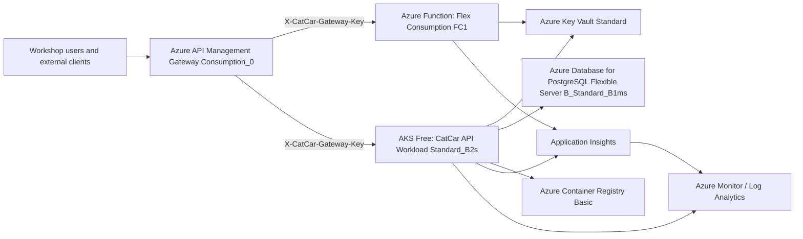

# Cloud Components

## Deployment topology (Academic Cloud Consolidation)

## Component responsibilities & cost profile

| Component | SKU / Tier | Responsibility | Security & Cost Boundary |
|---|---|---|---|
| **Azure API Management (APIM)** | `Consumption_0` | Serverless gateway, JWT validation, request shaping, `rate-limit` policies, backend key header injection. | Public ingress; injects `X-CatCar-Gateway-Key`. Serverless pay-per-call (first 1M free/month). |
| **Azure Function** | Flex Consumption (`FC1`, 512 MiB, max 2) | Customer CPF authentication & JWT issuance. Scales to zero when idle. | VNet integration (`snet-functions`); verifies origin Gateway Key on POST; Key Vault secret references. |
| **AKS Cluster** | `Free` (1–2 `Standard_B2s` nodes) | Hosts CatCar API modular monolith. HPA scaling (1–2 replicas at 70% CPU/memory). | Public LoadBalancer Service with static PIP FQDN; non-root, read-only FS, gateway key check. |
| **PostgreSQL Flexible Server** | `B_Standard_B1ms` (32 GiB) | Managed relational database (v17, logical database `catcar`, 4 Bounded Context schemas). | Private VNet subnet (`snet-postgresql`) & private DNS; public access disabled. Stopped nightly. |
| **Azure Key Vault** | `Standard` | Stores connection strings, JWT signing keys, and Gateway Backend Key. | Public endpoint enabled for OIDC runners; Entra ID RBAC authorization (`Key Vault Secrets User/Officer`). |
| **Azure Container Registry (ACR)** | `Basic` | Stores versioned, immutable workload container images tagged with SemVer and commit SHA. | Public endpoint enabled; admin disabled; AKS kubelet identity has `AcrPull`, deploy identity has `AcrPush`. |
| **Log Analytics & App Insights** | `PerGB2018` (30 days, 0.1 GB/day limit) | Telemetry ingestion, metrics, workbook dashboard, alert rules, and availability testing. | Centralized workspace in `catcar-prod`; daily quota cap prevents unexpected telemetry charges. |
| **Student Budget** | Subscription scope (`catcar-student-budget`) | Cumulative credit tracking aligned to credit expiration (`2028-08-31`). | Action group in `catcar-tfstate`; alerts at 50%, 75%, 90%, 100% actual and 90% forecast. |

## Network, Security and Deployment Flow

1. **Trunk-Based Delivery**: `main` is the single protected branch. CI runs on PRs and pushes to `main`. Production deployments run strictly on SemVer release tags (`v*.*.*`) whose commits are reachable from `main`.
2. **Multi-Repo Release Order**: Infrastructure foundation (`catcar-kubernetes-infra`) -> Database & Key Vault (`catcar-database-infra`) -> Customer Auth Function (`catcar-auth-function`) -> Application Workload (`catcar-app`).
3. **Gateway Key Ingress Boundary**: APIM injects `X-CatCar-Gateway-Key` and `X-Forwarded-Proto: https` on every request. Production origins reject POST requests missing or carrying an invalid key with HTTP 403. Health probes (`/health/live`, `/health/ready`) are exempt.
4. **Cold-by-Default Operations**: Compute workloads (AKS and PostgreSQL) are automatically stopped nightly at 02:00 UTC via `.github/workflows/cloud-runtime.yml` to preserve student credit, and started idempotently on demand via `workflow_dispatch` or deployment pipelines.

## Dated Pricing Basis (Azure Retail Prices API)

*Pricing query date: September 2026 (East US)*:
- **AKS Node**: `Standard_B2s` (2 vCPU, 4 GiB RAM) @ USD 0.0416/hour (~USD 1.00/day per node while running).
- **PostgreSQL Flex**: `B_Standard_B1ms` (1 vCPU, 2 GiB RAM) @ USD 0.017/hour + 32 GiB storage @ USD 0.115/GB/month.
- **ACR Basic**: USD 0.1666/day (~USD 5.00/month).
- **APIM Consumption**: USD 0.00 for first 1,000,000 requests/month.
- **Flex Consumption**: USD 0.00 for first 250,000 GB-s execution/month.
- **Scheduled Suspension**: Nightly stop ensures total spend remains well within the USD 100 student credit budget.
