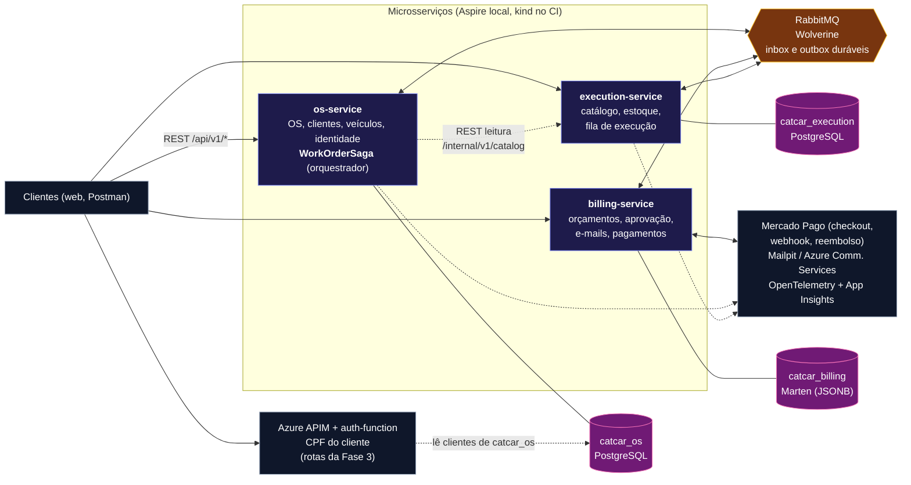

# Tech Challenge — Fase 4 | Documento Consolidado de Entrega

**Curso:** SOAT — Software Architecture Pós-Tech FIAP  
**Projeto:** CatCar Platform  
**Organização GitHub:** [RiseOn-CatCar](https://github.com/RiseOn-CatCar)  
**Versão do documento:** 20 de novembro de 2026

---

## 1. Identificação do grupo

| Campo | Informação |
|---|---|
| **Nome do grupo** | Grupo 274 |
| **Projeto** | CatCar Platform — Plataforma Integrada de Gestão de Oficina Mecânica |
| **Integrante** | Davi Holanda |
| **Turma / Curso** | SOAT — Software Architecture Pós-Tech FIAP |

## 2. Repositórios entregues

Três microsserviços independentes, cada um com código-fonte, `Dockerfile`, manifestos Kubernetes (`k8s/base` e `k8s/overlays/ci`), pipeline própria (`.github/workflows/ci.yml`), README com a arquitetura do serviço e evidências de cobertura. Mais o meta-repositório e os componentes de autenticação e infraestrutura mantidos da Fase 3.

| Repositório | Responsabilidade | Banco de dados |
|---|---|---|
| [catcar-os-service](https://github.com/RiseOn-CatCar/catcar-os-service) | **OS Service**: ordens de serviço, clientes, veículos e identidade administrativa; hospeda a Saga orquestrada. Renomeado de `catcar-app`. | PostgreSQL `catcar_os` (EF Core) |
| [catcar-billing-service](https://github.com/RiseOn-CatCar/catcar-billing-service) | **Billing Service**: orçamentos, links de aprovação, e-mails e pagamentos Mercado Pago. | **Marten** (documentos JSONB) `catcar_billing` |
| [catcar-execution-service](https://github.com/RiseOn-CatCar/catcar-execution-service) | **Execution Service**: catálogo de serviços, estoque, reservas e fila de execução. | PostgreSQL `catcar_execution` (EF Core) |
| [catcar-platform](https://github.com/RiseOn-CatCar/catcar-platform) | Meta-repositório: submódulos, contratos de mensagens, AppHost do Aspire, coleção Postman e esta entrega. | — |
| [catcar-auth-function](https://github.com/RiseOn-CatCar/catcar-auth-function) | Azure Function de autenticação do cliente por CPF e emissão de JWT. | Sem banco próprio; consulta interna ao OS Service |
| [catcar-database-infra](https://github.com/RiseOn-CatCar/catcar-database-infra) | Terraform do PostgreSQL Flexible Server, Key Vault, DNS privado e segredos (Fase 3). | — |
| [catcar-kubernetes-infra](https://github.com/RiseOn-CatCar/catcar-kubernetes-infra) | Terraform de VNet, AKS, ACR, APIM, Azure Monitor, alertas e workbooks (Fase 3). | — |

**Collection Postman atualizada (v2.1.0):** [`CatCar_Platform.postman_collection.json`](https://github.com/RiseOn-CatCar/catcar-platform/blob/main/docs/postman/CatCar_Platform.postman_collection.json) e [environment](https://github.com/RiseOn-CatCar/catcar-platform/blob/main/docs/postman/CatCar_Platform.postman_environment.json), com variáveis de base por serviço (`osBaseUrl`, `billingBaseUrl`, `executionBaseUrl`, `authBaseUrl`). O OS Service expõe OpenAPI em `/docs` e `/openapi/v1.json` nos ambientes `Development` e `LocalKubernetes`.

## 3. Vídeo de demonstração

**Link do vídeo: a ser incluído.** (Upload no YouTube/Vimeo, até 15 minutos, público ou não listado: fluxo completo de uma OS entre os microsserviços, execução da Saga com tratamento de falhas, deploy automatizado com validação de testes e monitoramento dos fluxos distribuídos.)

## 4. Arquitetura geral

### Comunicação entre serviços

- **Assíncrona (principal):** RabbitMQ com `WolverineFx.RabbitMQ`, roteamento convencional (uma exchange por identidade de mensagem e uma fila por consumidor), inbox e outbox duráveis. Toda mensagem tem `[MessageIdentity("catcar.<produtor>.<nome>.v1")]`, `WorkOrderId` e `CorrelationId`. Cada serviço mantém a **própria cópia** dos tipos (sem biblioteca compartilhada), com testes de contrato que comparam os nomes dos campos serializados.
- **Síncrona (exceção, somente leitura):** o OS Service consulta o catálogo do Execution Service em `GET /internal/v1/catalog/services/{id}` e `/parts/{id}`. A Function consulta clientes no OS Service por API interna protegida por chave; as rotas internas não são publicadas no APIM.
- **Isolamento de dados:** nenhum serviço acessa o banco de outro. As informações do cliente necessárias ao Billing viajam nas mensagens (`RequestBudget`, `WorkOrderStatusChanged`).
- **Autenticação:** os três serviços validam o mesmo JWT administrativo emitido pelo OS Service; o JWT de cliente é emitido pela Azure Function.

Contratos detalhados, mensagens e tabela da Saga: [`docs/architecture/messaging-contracts.md`](https://github.com/RiseOn-CatCar/catcar-platform/blob/main/docs/architecture/messaging-contracts.md).

## 5. Estratégia do Saga Pattern: orquestração

### Escolha e justificativa

A Saga é **orquestrada**, implementada pela classe `WorkOrderSaga` (`Wolverine.Saga`, `Id = WorkOrderId`) no OS Service, com estado persistido no EF Core (`ServiceOperationsDbContext`).

- O fluxo é longo e sequencial (orçamento → aprovação → reserva de peças → pagamento → execução), com **compensações diferentes por etapa**. Na coreografia, essa lógica ficaria espalhada pelos três serviços e cada mudança de fluxo exigiria alterar vários consumidores.
- Estado, timeouts e compensações ficam em um único lugar, o que facilita testar (BDD), auditar e demonstrar.
- O OS Service já é o dono do agregado `WorkOrder`: a mudança de estado da OS e o estado da Saga são gravados na mesma transação.
- O Wolverine já fornece Saga, `TimeoutMessage` e outbox transacional, sem um motor de workflow adicional.
- Billing e Execution não conhecem o fluxo: recebem comandos e respondem com eventos; as compensações são comandos idempotentes e sem resposta.
- **Custo aceito:** o OS Service é um ponto central de coordenação. O risco é mitigado por inbox/outbox duráveis, retentativas e idempotência (mensagens duplicadas ou fora de estado são ignoradas; `NotFound` registra log e ignora).

### Fluxo, estados e compensações

| Mensagem recebida | Pré-condição na Saga | Ação na OS | Mensagens enviadas | Estado da OS |
|---|---|---|---|---|
| (início) `POST .../work-orders/{id}/budget` | OS `InDiagnosis` com ao menos 1 linha | — | `RequestBudget`, `ApprovalTimeout` agendado | `InDiagnosis` |
| `BudgetIssued` | aguardando orçamento | `MarkBudgetIssued` | — | `AwaitingApproval` |
| `BudgetRejected` | aguardando aprovação | `RecordApproval(false)` | — (fim) | `InDiagnosis` |
| `ApprovalTimeout` | aguardando aprovação | `Cancel` | `CancelBudget` (fim) | `Cancelled` |
| `BudgetApproved` | aguardando aprovação | `RecordApproval(true)` | `ReserveParts` | `AwaitingApproval` |
| `PartsReservationFailed` | aguardando reserva | `RecordInventoryReservationFailure` | `CancelBudget` (fim) | `InDiagnosis` |
| `PartsReserved` | aguardando reserva | `AwaitPayment` | `RequestPayment`, `PaymentTimeout` agendado | `AwaitingPayment` |
| `PaymentFailed` ou `PaymentTimeout` | aguardando pagamento | `Cancel` | `ReleaseParts`, `CancelBudget` (fim) | `Cancelled` |
| `PaymentConfirmed` | aguardando pagamento | `StartExecution` | `StartExecution` | `InExecution` |
| `ExecutionFailed` | em execução | `Cancel` | `RefundPayment`, `ReleaseParts` (fim) | `Cancelled` |
| `ExecutionCompleted` | em execução | `Complete` | — (fim) | `Completed` |

- A entrega (`Delivered`) continua sendo um comando administrativo fora da Saga; `MarkCompleted()` é chamado em todo estado final.
- Toda transição publica `catcar.os.work-order-status-changed.v1`, consumido pelo Billing para os e-mails de status.
- **Timeouts:** `Saga:ApprovalTimeout` (padrão 72 h) e `Saga:PaymentTimeout` (padrão 24 h), implementados como `TimeoutMessage` agendada pelo outbox durável.
- **Compensações executadas pelos participantes:** `CancelBudget` cancela o orçamento e expira os tokens de aprovação; `ReleaseParts` devolve as peças ao estoque; `RefundPayment` reembolsa no Mercado Pago um pagamento confirmado.

## 6. Justificativa da divisão e das tecnologias

### Divisão dos microsserviços

| Serviço | Bounded context | Por que separado |
|---|---|---|
| OS Service | `ServiceOperations` (clientes, veículos, OS) e `IdentityAccess` | Dono do agregado central e do estado da Saga; naturalmente o ponto de consulta de status e histórico. Reaproveitou o núcleo do antigo monólito `catcar-app`. |
| Billing Service | Orçamentos (`Budgets`), comunicação (links de aprovação e e-mails) e pagamentos | Vida própria, integração externa (Mercado Pago), dados de cliente desacoplados por evento e modelo de documentos adequado ao orçamento. |
| Execution Service | `CatalogInventory` (catálogo, estoque, reservas) e fila de execução | Trabalho operacional da oficina, com concorrência de estoque e fila própria; escala independentemente do atendimento. |

A divisão segue os três serviços sugeridos no enunciado e os bounded contexts já identificados no DDD das fases anteriores. Cada serviço tem repositório, banco, imagem, manifestos e pipeline próprios, e nenhum depende de outro para compilar.

### Tecnologias

| Tecnologia | Onde | Justificativa |
|---|---|---|
| .NET 11 / ASP.NET Core | Três serviços | Mesma plataforma das fases anteriores, com `TreatWarningsAsErrors`, fatias verticais e DDD. |
| **PostgreSQL + EF Core** | OS (`catcar_os`) e Execution (`catcar_execution`) | Requisito de banco **relacional (SQL)**. Modelos fortemente relacionais, com integridade referencial, transações e concorrência otimista (`xmin`) — essencial para que duas reservas não consumam a mesma peça. Reaproveita migrations e repositórios. |
| **Marten (documentos JSONB no banco `catcar_billing`)** | Billing | Requisito de banco **não relacional (NoSQL)**. O orçamento é um agregado que nasce, é lido e muda como um todo: documento único com as linhas embutidas, sem junções nem migrações a cada evolução de formato. `Budget`, `Payment`, `ExternalAccessToken` e `BudgetCustomer` são documentos com concorrência otimista, consultados por LINQ. O Marten é a integração oficial do Wolverine para inbox, outbox e Saga (`IntegrateWithWolverine`), o que permite gravar o documento e publicar o evento na mesma transação; para MongoDB existe apenas pacote comunitário. **Tradeoff assumido:** o motor é o PostgreSQL, não um servidor NoSQL separado com escala horizontal própria (MongoDB, Cosmos DB). Em troca há uma única tecnologia operacional, transações ACID entre documentos e fila, e um banco separado que nenhum outro serviço acessa. O risco de não aceitação foi identificado e é mitigado pela documentação do modelo de documentos. |
| **RabbitMQ** | Mensageria dos três serviços | Exigido como opção de mensageria no enunciado; roda da mesma forma no Aspire, no kind e no AKS, com painel de administração para inspecionar filas durante a demonstração. |
| **Wolverine 6** | Três serviços | Handlers, roteamento convencional, inbox/outbox duráveis, Saga e `TimeoutMessage`. Evita escrever a infraestrutura de mensageria e garante publicação transacional junto à mudança de estado. |
| **.NET Aspire (AppHost)** | Desenvolvimento local | Um único AppHost no meta-repositório sobe PostgreSQL (3 bancos), RabbitMQ, Mailpit, os três serviços e a Function, com service discovery, health checks e dashboard de traces — sem AppHost duplicado por serviço. |
| **kind (Kubernetes in Docker) no CI** | Job `deploy-kind` de cada serviço | Prova o deploy automatizado em Kubernetes (imagem, migração, rollout e smoke) em todo PR, sem custo de nuvem e sem depender do ambiente Azure efêmero. |
| **SonarCloud** | Job `sonar` de cada serviço | Exigência de validação de qualidade no CI: organização `riseon`, projetos `riseon_catcar-*-service`, com quality gate bloqueante e cobertura importada do coverlet. |
| Reqnroll, xUnit, Testcontainers | Testes | BDD executável para a Saga, testes unitários e de integração com PostgreSQL e RabbitMQ reais em containers. |

## 7. Testes, BDD e cobertura

| Serviço | Testes | Cobertura de linhas (código de `src`, sem Migrations/Program/gerado) | Gate |
|---|---|---|---|
| OS Service | 375 | **95,81%** | 80% |
| Billing Service | 172 | **91,79%** | 80% |
| Execution Service | 127 | **92,96%** | 80% |

- **BDD (fluxo completo):** [`WorkOrderSaga.feature`](https://github.com/RiseOn-CatCar/catcar-os-service/blob/main/tests/Contexts/ServiceOperations.Tests/Features/WorkOrders/Saga/WorkOrderSaga.feature) (Reqnroll) cobre o fluxo feliz — orçamento, aprovação, reserva de peças, pagamento e execução até `Completed` — e os cenários de falha: rejeição do orçamento, timeout de aprovação, falha de estoque, falha e timeout de pagamento (liberação de peças e cancelamento do orçamento), falha de execução (reembolso e liberação) e confirmação de pagamento duplicada ignorada. Os passos usam PostgreSQL real (Testcontainers) e um outbox simulado que registra os comandos publicados; os eventos dos outros serviços são entregues aos handlers da Saga.
- **Testes de contrato** validam as identidades e os campos das mensagens em cada serviço.
- **Evidências por serviço (badges de quality gate e cobertura no README):**
  - OS Service: [SonarCloud](https://sonarcloud.io/project/overview?id=riseon_catcar-os-service) · [CI](https://github.com/RiseOn-CatCar/catcar-os-service/actions/workflows/ci.yml) · [PR #12](https://github.com/RiseOn-CatCar/catcar-os-service/pull/12)
  - Billing Service: [SonarCloud](https://sonarcloud.io/project/overview?id=riseon_catcar-billing-service) · [CI](https://github.com/RiseOn-CatCar/catcar-billing-service/actions/workflows/ci.yml) · [PR #1](https://github.com/RiseOn-CatCar/catcar-billing-service/pull/1)
  - Execution Service: [SonarCloud](https://sonarcloud.io/project/overview?id=riseon_catcar-execution-service) · [CI](https://github.com/RiseOn-CatCar/catcar-execution-service/actions/workflows/ci.yml) · [PR #1](https://github.com/RiseOn-CatCar/catcar-execution-service/pull/1)
- O relatório OpenCover de cada execução é publicado como artefato do job `build-test`.

## 8. CI/CD e proteção de branches

Pipeline independente por serviço (`.github/workflows/ci.yml`), executada em todo pull request e push na `main`:

| Job | Conteúdo |
|---|---|
| `build-test` | restore, verificação de formatação, build Release, testes com coverlet (OpenCover) e **falha abaixo de 80%** de cobertura de linhas do serviço. |
| `sonar` | análise no SonarCloud com cobertura e quality gate em modo wait. |
| `security` | Opengrep (SAST), `dotnet package list --vulnerable` (falha em Critical/High) e Trivy na imagem (falha em CRITICAL/HIGH). |
| `deploy-kind` | cluster kind efêmero no runner, build e `kind load` da imagem, `kubectl apply -k k8s/overlays/ci` (serviço + PostgreSQL + RabbitMQ efêmeros), Job de migração, espera do rollout e smoke em `/health/ready` e em um endpoint público. |

**Proteção da `main` nos três repositórios:** pull request obrigatório e checks obrigatórios `build-test`, `security`, `sonar` e `deploy-kind`. Os PRs `os-service#12`, `billing-service#1` e `execution-service#1` foram aprovados com os quatro checks verdes.

O meta-repositório continua fixando os commits dos componentes como submódulos; a publicação no Azure por tag estrita `vMAJOR.MINOR.PATCH` permanece no layout da Fase 3.

## 9. Observabilidade

- **OpenTelemetry** no `ServiceDefaults` compartilhado: traces, métricas e logs de ASP.NET Core e `HttpClient`, com a fonte `Wolverine` adicionada ao tracer. Como os comandos e eventos trafegam pelo Wolverine, **o trace distribuído atravessa o RabbitMQ** e mostra a Saga de ponta a ponta.
- **Local:** exportação OTLP para o dashboard do Aspire, com logs, métricas e traces por recurso, além do painel do RabbitMQ e do Mailpit para inspecionar mensagens e e-mails.
- **Nuvem:** o `ServiceDefaults` também suporta Azure Monitor/Application Insights, mantendo a stack da Fase 3 (Application Insights, Log Analytics, alertas e workbooks) como alvo quando os serviços forem publicados no AKS.
- **Saúde:** `/health/live` e `/health/ready` em todos os serviços, usadas pelos probes do Kubernetes e pelo smoke do CI.

## 10. Limites de escopo e pendências

| Item | Situação |
|---|---|
| Publicação dos novos serviços no AKS e rotas no APIM | Fora do escopo da Fase 4. O release no Azure continua no layout da Fase 3 (imagem única); o deploy automatizado em Kubernetes é demonstrado pelo job `deploy-kind` de cada serviço. |
| Deploy da autenticação no Azure | A nova consulta interna exige reconciliar a URL do OS Service, a chave compartilhada e as configurações legadas de banco antes de uma nova release. |
| Validação ao vivo do Mercado Pago e **simulador de pagamento** | O adaptador do Mercado Pago está implementado (checkout, webhook com assinatura, polling e reembolso) e coberto por testes com HTTP simulado, mas **não foi validado contra o sandbox real**: a conta de teste do Mercado Pago não pôde ser criada por indisponibilidade do serviço. Para demonstrar o fluxo completo, o Billing tem um **simulador de pagamento, explicitamente rotulado como simulação**: selecionado por `Payments:Provider=Simulator` (o padrão continua sendo `MercadoPago`), exibe a página `SIMULATION - this is NOT Mercado Pago and no money moves`, grava `provider: simulator` e referências `SIM-` e é recusado em Production sem `Payments:Simulator:AllowInProduction=true`. As decisões (aprovar, rejeitar, deixar pendente) passam pelo mesmo fluxo interno do webhook real. Sem credencial e sem simulador, o Billing publica `PaymentFailed` (`payment-provider-not-configured`) e a Saga compensa. No AppHost local, o simulador entra automaticamente quando nenhuma credencial do Mercado Pago está configurada. |
| Testes E2E entre repositórios | Fora do escopo; a Saga é exercitada por BDD no OS Service e os serviços por testes de integração próprios. |
| Vídeo de demonstração | **Link do vídeo: a ser incluído.** |

## 11. Metodologia e papel da Inteligência Artificial

A Inteligência Artificial foi empregada como multiplicação de mão de obra: um recurso para ampliar, acelerar e sistematizar a execução do trabalho de engenharia. Os conceitos arquiteturais, padrões de design e decisões técnicas — divisão dos microsserviços, Saga orquestrada com compensações, Transactional Outbox, escolha do Marten como banco de documentos, contratos por identidade de mensagem e o desenho das pipelines — foram originados do conhecimento arquitetural e da experiência de engenharia do autor, **Davi Holanda**. A assistência de IA potencializou a materialização dessas decisões, sem substituir sua autoria técnica.
